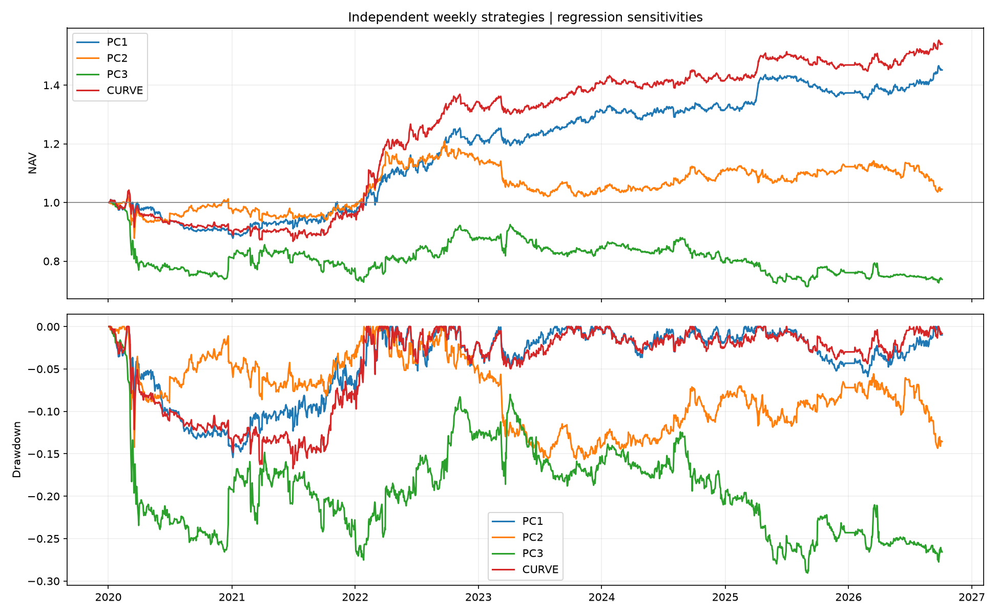

# Treasury PCA Strategy

Research on the U.S. Treasury yield curve: extract PCA factors from daily 2Y, 5Y, 10Y and 30Y yield changes, forecast five-observation cumulative factor changes using macro-augmented Ridge with monthly expanding refits, and evaluate weekly Treasury futures portfolios.

## Installation

Python 3.12 is recommended and matches the development environment. Run commands from the repository root:

```bash
python3.12 -m venv .venv
source .venv/bin/activate
python -m pip install -r requirements.txt
```

All dependencies are in `requirements.txt`: data access, PCA, Ridge, LightGBM, plotting, pytest, Backtrader and exchange calendars. Version ranges are not a fully locked environment.

Set `FRED_API_KEY=your_key` in a local `.env` file at the repository root, or use the environment variable of the same name. Environment variables take precedence. Never commit actual credentials.

## Workflow

Prepare data and generate macro-augmented forecasts:

```bash
python scripts/prepare_data.py
python scripts/run_forecasts.py --model ridge
```

Preparation covers Treasury yields, historical releases and revisions of unemployment/CPI/core PCE, and Yahoo ZT/ZF/ZN/ZB futures daily bars. Forecasting reruns historical out-of-sample predictions with monthly refits; it does not only predict the latest date.

With local data and forecasts available, regenerate both portfolio families and backtest all four strategies:

```bash
python scripts/run_pipeline.py
```

The default pipeline does not download data or refit forecasting models. It updates the configured signal and backtest directories, then saves `summary.csv` and `equity_comparison.png` in `results/backtest/comparison_regression/`. A failed stage stops the run. Earlier stage outputs may already have changed; an old comparison file does not indicate that the new run completed.

For a full data and forecast refresh:

```bash
python scripts/run_pipeline.py --refresh-data --refit
```

Use `--refresh-data --offline --refit` to rebuild from caches, or `--dry-run` to print commands without executing them.

Individual stages can also be run separately. PC1, PC2 and PC3 use independent accounts:

```bash
python scripts/generate_signals.py --config config/backtest_capacity.yaml
python scripts/run_backtest.py --config config/backtest_capacity.yaml
```

The unified curve strategy uses one account:

```bash
python scripts/generate_signals.py --config config/backtest_curve.yaml
python scripts/run_backtest.py --config config/backtest_curve.yaml
```

Both entry points default to the PC configuration. Regenerate signals after any configuration change. Each account starts with USD 10 million, a five-day P&L standard-deviation budget of 1% of initial capital, and a margin-use cap of 50% of initial capital. These are risk limits, not maximum-loss guarantees.

## Implementation

- `src/data/`: Treasury yields, macro vintages and futures data access.
- `src/models/`: forecasting models and expanding evaluation.
- `src/portfolio/factor_positions.py`: PC targets and shared regression, calendar and integer position sizing.
- `src/portfolio/curve_positions.py`: unified curve targets, using negative forecast changes divided by historical five-day yield standard deviations.
- `src/backtest/futures_engine.py`: execution, margin accounting, costs and P&L from precomputed target positions.

Rolling multivariate regressions use information through each signal date to explain per-contract dollar P&L with yield changes. The resulting sensitivity matrix maps desired curve exposures into contract quantities. Historical five-day futures P&L covariance determines overall position size. There are no calendar-based roll exclusions; iterative residual outlier filtering remains enabled.

Targets are formed after the final session of each week and executed at the next session open. Orders adjust the difference between target and actual positions. Missing bars are carried for valuation only and prevent basket execution. Costs are USD 2.50 per contract per side plus half a tick charged as an additional dollar expense.

See [data and forecasts](docs/data_and_forecasts.md), [backtest workflow](docs/backtest.md) and [regression position sizing](docs/regression_sensitivity.md).

## Data and outputs

| Location | Contents |
|---|---|
| `data/raw/`, `data/processed/` | Raw caches and processed datasets; futures JSON and CSV files are in their futures subdirectories |
| `results/forecast/ridge/` | Ridge forecasts, metrics and PCA loadings |
| `results/signals/ridge_capacity_regression/` | Weekly PC targets and regression diagnostics |
| `results/backtest/ridge_capacity_regression/` | PC equity, orders, positions, metrics and plots |
| Corresponding `ridge_curve_regression/` directories | Unified curve targets and backtests |

Other commands:

```bash
python scripts/prepare_data.py --offline
python scripts/run_pca.py
python scripts/plot_forecast_results.py --model ridge
python -m pytest tests -q
```

Offline preparation fails if required caches are missing. Main data and futures settings are in `config/base.yaml`; macro settings are in `config/macro.yaml`. PCA diagnostics are optional for the main workflow. Forecast plotting reads existing outputs. LightGBM can be selected with `run_forecasts.py --model lgbm`.

The old standalone audit script was removed. Independent P&L accounting checks remain in the test suite.

## Stage results — October 20, 2026

The current research stage includes macro-augmented Ridge, three PC strategies and one unified curve strategy. The backtest covers **January 3, 2020 through October 5, 2026**. Each strategy is a separate USD 10 million account with the risk limits above. Returns include configured commissions and slippage, but no cash interest.

| Strategy | Total return | Annualized return | Annualized volatility | Maximum drawdown | Sharpe (zero risk-free rate) | Total costs |
|---|---:|---:|---:|---:|---:|---:|
| PC1 | 45.15% | 5.67% | 7.67% | -15.43% | 0.74 | $481,101 |
| PC2 | 4.52% | 0.66% | 9.02% | -15.66% | 0.12 | $2,079,180 |
| PC3 | -26.20% | -4.40% | 12.24% | -29.05% | -0.30 | $2,460,988 |
| CURVE | 54.03% | 6.60% | 8.36% | -16.75% | 0.79 | $1,385,778 |



[Machine-readable summary](docs/results/summary.csv) · [Run time and input hashes](docs/results/provenance.json)

These results are not directly comparable with the former proxy-DV01 version: allocation mapping, risk budgets and margin assumptions changed. Obsolete local results were removed. Full current outputs remain in `results/`; `docs/results/` is the published snapshot and is not automatically updated by subsequent pipeline runs.

The unified curve and PC1 were profitable in this sample; costs materially reduced PC2 returns, and PC3 lost money. Future research should prioritize allocation stability, turnover, costs, roll handling and stress risk.

## Next development phase

The [next-phase implementation plan](docs/next_steps.md) prioritizes actual dated futures data, explicit contract rolls and costs, a rebuilt historical-risk baseline, and GARCH-based volatility sizing. It defines data requirements, integration points and acceptance tests. These changes are planned, not yet implemented.

## Limitations and repository scope

Yahoo continuous-contract selection and adjustment are unverified. Regression sensitivities are not CTD valuation DV01. The engine does not model explicit contract rolls and roll costs, cash interest, or complete initial/maintenance-margin and liquidation procedures. Filtering may understate tail risk. These are exploratory research results, not validated executable returns.

`Treasury_PCA_Strategy_Roadmap.md` records early research objectives and possible extensions, not the current runbook or task list.

Version control includes source, configuration, dependencies, tests, documentation and the published result snapshot. Credentials, environments, raw data, full generated results, caches and personal research notes are excluded. Ignore rules do not remove files from earlier Git history. Full datasets and execution outputs remain local.
